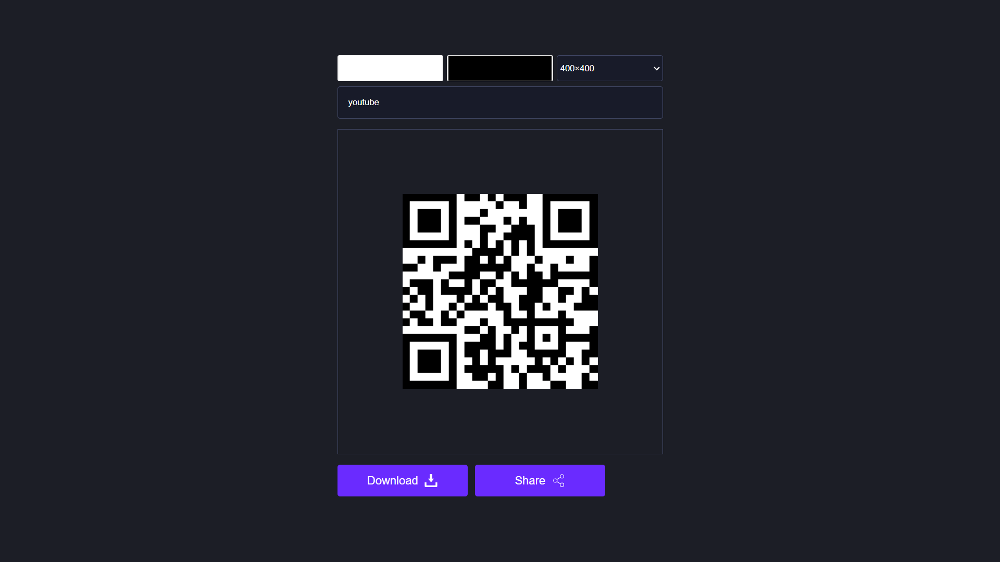

# QR Code Generator

Turn text or a link into a QR code, then download or share it.

## Features

- Choose QR code size and colours
- Download as an image
- Share with the Web Share API where supported

## Run it

No build step. Open `index.html` in a browser, or serve the folder with any static server, for example `python -m http.server`.

## Notes

- Uses the QRCode.js library from a CDN.

## Screenshots

